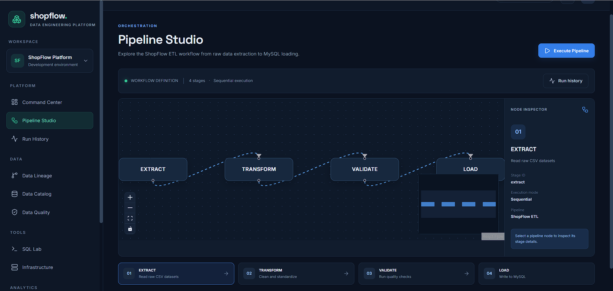
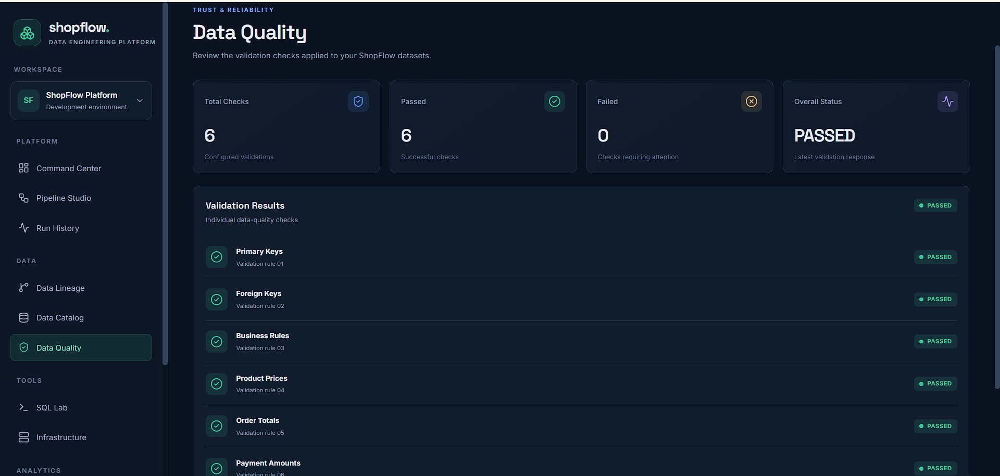

# ⚡ ShopFlow — E-Commerce Data Engineering Platform

<p align="center">

# 🚀 [CLICK HERE TO EXPLORE THE LIVE DASHBOARD](https://shop-flow-data-engineering.vercel.app/)

**Interactive Demo · No Login Required**

</p>

**GitHub Repository:** [ShopFlow — Data Engineering](https://github.com/khan-mutahar/ShopFlow-Data-Engineering)

---

An end-to-end Data Engineering project simulating an e-commerce data ecosystem using **Python, Pandas, MySQL, FastAPI, and React**.

## 📸 Dashboard Preview





## 🎯 Project Overview

ShopFlow simulates how an e-commerce company processes data from multiple sources through an ETL pipeline.

It generates five interconnected datasets — customers, products, orders, order items, and payments — and demonstrates data extraction, transformation, validation, and loading into MySQL.

## ✨ Key Features

- **ETL Pipeline:** Extract, transform, validate, and load.
- **Data Quality:** Primary key, foreign key, duplicate, null, and business rule checks.
- **Pipeline Monitoring:** Run history, execution status, and stage tracking.
- **Data Lineage:** Visualize relationships and data flow.
- **Data Catalog:** Explore five e-commerce datasets.
- **SQL Lab:** Read-only SQL exploration.
- **Business Insights:** Interactive charts and analytics.

## 🏗️ Architecture

```text
Synthetic CSV Data
       ↓
    Extract
       ↓
   Transform
       ↓
    Validate
       ↓
      Load
       ↓
     MySQL
       ↓
    FastAPI
       ↓
 React Dashboard
```

## 🛠️ Tech Stack

Python · Pandas · Faker · MySQL · FastAPI · React · Vite · Recharts · React Flow · Axios · Git · GitHub · Vercel

## 🚀 Run Locally

**1. Clone the repository**
```bash
git clone https://github.com/khan-mutahar/ShopFlow-Data-Engineering.git
cd ShopFlow-Data-Engineering
```

**2. Set up Python**
```bash
python -m venv venv
venv\Scripts\activate
pip install -r requirements.txt
```

**3. Configure MySQL**

Create a `.env` file using `.env.example` and configure your database credentials. Execute `sql/shopflow_database.sql`.

**4. Generate data**
```bash
python generate_data.py
```

**5. Start the backend**
```bash
uvicorn api.main:app --reload
```

**6. Start the frontend** (in another terminal)
```bash
cd frontend
npm install
npm run dev
```

## 🌐 Demo Information

The public dashboard uses simulated demo data for easy access. The Python ETL pipeline, MySQL integration, and FastAPI backend are maintained in the repository. The deployed demo does not execute the ETL pipeline against a live database.

## 🔮 Future Improvements

- Apache Airflow orchestration.
- Incremental data loading.
- Automated pipeline scheduling.
- Cloud data warehouse integration.
- CI/CD and automated testing.

## 👨‍💻 Author

**MOHAMMAD MUTAHAR KHAN**  
BTech — Artificial Intelligence & Data Science

[GitHub](https://github.com/khan-mutahar) · [Project Repository](https://github.com/khan-mutahar/ShopFlow-Data-Engineering)

---

<p align="center">

**Built with Python, curiosity, and a passion for Data Engineering.**

</p>